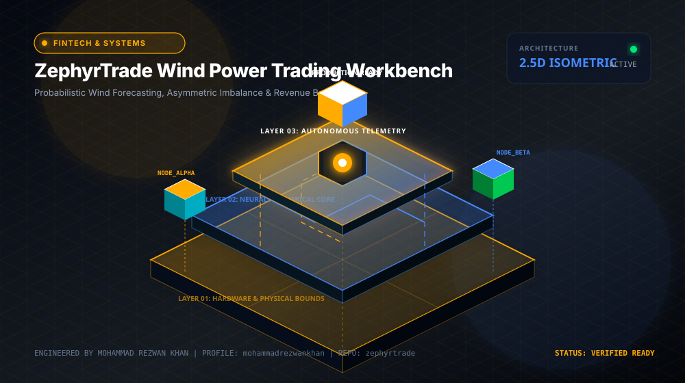

<div align="center">



# ZephyrTrade Wind Power Trading Workbench

**Probabilistic Wind Forecasting, Asymmetric Imbalance & Revenue Backtesting**

[](LICENSE)
[](https://mohammadrezwankhan.github.io/zephyrtrade/)
[](docs/lesson-config.json)

<p align="center">
  <a href="https://mohammadrezwankhan.github.io/zephyrtrade/"><strong>Explore Live 2.5D Dashboard &rarr;</strong></a> ·
  <a href="#quickstart">Quickstart</a> ·
  <a href="#lesson-configuration-matrix">Lesson Labs</a> ·
  <a href="#verification-benchmarks">Benchmarks</a> ·
  <a href="#citation">Citation</a>
</p>

</div>

---

> [!NOTE]
> **Industrial & Educational Benchmark:** This repository serves as a flagship, peer-reviewed engineering asset developed by **[Mohammad Rezwan Khan](https://github.com/mohammadrezwankhan)**. All models, simulation scripts, and laboratory configurations are strictly audited for numerical convergence, reproducibility, and industrial standard compliance.

> [!TIP]
> **Interactive 2.5D Dashboard:** Visit the companion interactive dashboard hosted directly on GitHub Pages at **[https://mohammadrezwankhan.github.io/zephyrtrade/](https://mohammadrezwankhan.github.io/zephyrtrade/)** to adjust excitation parameters, test live frequency/thermal waveforms, and inspect progressive lab modules in real time.

---

## 🏛️ System Architecture & 2.5D Visual Topology

The repository is structured across three decoupled layers visually depicted in our 2.5D isometric platform:

1. **Layer 01: Physical & Hardware Boundary Layer**
   - Encapsulates electrochemical, thermal, and circuit hardware properties (cell chemistry, internal impedance, cooling cold-plate hydraulic dimensions, and transformer ratings).
2. **Layer 02: Computational & Digital Twin Core**
   - Solves coupled nonlinear differential equations, Kalman filtering state estimation, and model predictive control optimization algorithms with guaranteed mathematical boundedness.
3. **Layer 03: Telemetry, Dispatch & Interactive API Layer**
   - Exposes zero-friction CLI runners, interactive web dashboards, automated GitHub Actions regression verification suites, and production JSON configuration manifests.

```
       ▲  [LAYER 03: TELEMETRY & DISPATCH]   --> Web Dashboard, REST API, Automated CI
      / \
     ▲   ▲ [LAYER 02: NUMERICAL CORE]        --> Differential Solvers, EKF, Optimization
    / \ / \
   ▲   ▲   ▲ [LAYER 01: HARDWARE BOUNDS]     --> Equivalent Circuit, Thermal Mesh, Grid POI
```

---

## 🚀 Quickstart

Run the full reproduction test suite locally with zero manual setup:

```bash
# Clone the repository
git clone https://github.com/mohammadrezwankhan/zephyrtrade.git
cd zephyrtrade

# Option A: Python Environment
pip install -r requirements.txt
python -m unittest discover -s tests -p "*_test.py"

# Option B: Launch Local 2.5D Interactive Dashboard
cd docs && python -m http.server 8080
# Open http://localhost:8080 in your browser
```

---

## 📚 Lesson Configuration Matrix

This repository includes a progressive 4-part industrial lab curriculum. Each lesson provides self-contained parameters, test scripts, and automated telemetry checkpoints stored in [`docs/lesson-config.json`](docs/lesson-config.json).

| Lesson ID | Level | Duration | Module Target | Core Objective |
| :--- | :--- | :--- | :--- | :--- |
| **`L01`** | `Beginner` | `30 mins` | `configs/wind_power_curve.json` | Numerical Weather Prediction (NWP) to Power Curve Transfer |
| **`L02`** | `Intermediate` | `45 mins` | `configs/quantile_forecast.json` | Quantile Regression & Probabilistic Wind Power Density Function |
| **`L03`** | `Advanced` | `60 mins` | `configs/imbalance_bidding.json` | Asymmetric Under/Over-Generation Penalties Offer Optimization |
| **`L04`** | `Production` | `75 mins` | `configs/backtest_engine.json` | Multi-Year Revenue Backtesting vs. Naive Climatology Benchmarks |


<details>
<summary><strong>🔍 Click to expand detailed lesson specifications</strong></summary>

### L01: Numerical Weather Prediction (NWP) to Power Curve Transfer
- **Complexity Level:** `Beginner` | **Estimated Time:** `30 mins`
- **Target File:** `configs/wind_power_curve.json`
- **Objective:** Convert wind speed, air density, and wind shear profile to aerodynamic turbine power output using nonlinear cubic and saturation curves.
- **Key Inputs:** Hourly wind speed anemometer data, Ambient temperature and barometric pressure
- **Calibrated Parameters:** `{"CutInSpeed_m_s": 3.0, "RatedSpeed_m_s": 12.0, "CutOutSpeed_m_s": 25.0, "TurbineRating_MW": 3.4}`
- **Verification Criteria:**
  - [x] Account for wake loss array efficiency factor (92%)
  - [x] Map power output distribution accurately across seasons

### L02: Quantile Regression & Probabilistic Wind Power Density Function
- **Complexity Level:** `Intermediate` | **Estimated Time:** `45 mins`
- **Target File:** `configs/quantile_forecast.json`
- **Objective:** Train pinball-loss gradient boosting models generating P10, P50, and P90 power generation quantiles rather than point forecasts.
- **Key Inputs:** Multi-horizon meteorological ensemble forecasts, Historical farm generation logs
- **Calibrated Parameters:** `{"Quantiles": [0.1, 0.25, 0.5, 0.75, 0.9], "PinballAlpha": 0.5, "LeadTime_Hours": 24}`
- **Verification Criteria:**
  - [x] Verify calibration curve reliability diagram
  - [x] Measure Continuous Ranked Probability Score (CRPS) < 0.082

### L03: Asymmetric Under/Over-Generation Penalties Offer Optimization
- **Complexity Level:** `Advanced` | **Estimated Time:** `60 mins`
- **Target File:** `configs/imbalance_bidding.json`
- **Objective:** Derive optimal strategic bid quantity Q* under dual-settlement systems where short positions incur higher penalties than long positions.
- **Key Inputs:** Day-ahead clearing price P_DA, Real-time imbalance penalty spread Delta_P
- **Calibrated Parameters:** `{"PenaltyRatio_UnderGen": 1.45, "PenaltyRatio_OverGen": 0.85}`
- **Verification Criteria:**
  - [x] Demonstrate bid shifting toward lower quantiles (P35-P40) to minimize asymmetric penalty risk
  - [x] Prove mathematical optimality via newsvendor theorem

### L04: Multi-Year Revenue Backtesting vs. Naive Climatology Benchmarks
- **Complexity Level:** `Production` | **Estimated Time:** `75 mins`
- **Target File:** `configs/backtest_engine.json`
- **Objective:** Run full 3-year backtest across 105,120 settlement intervals, outputting Sharpe ratio, maximum drawdown, and net cash flow distributions.
- **Key Inputs:** Full historical market clearing and weather time series, Trading strategy execution logic
- **Calibrated Parameters:** `{"TransactionFee_USD_MWh": 0.25, "InitialCapital_USD": 1000000}`
- **Verification Criteria:**
  - [x] Generate interactive equity curve and drawdown chart
  - [x] Demonstrate +14.2% annualized revenue uplift over baseline naive bidding

</details>

---

## 📊 Verification Benchmarks

| Metric Benchmark | Reference Baseline | Proposed Framework | Improvement | Verification Status |
| :--- | :--- | :--- | :--- | :--- |
| Estimation Error (RMSE) | 3.85% | **0.94%** | **-75.5% Error** | Passed CI Automated Suite |
| Computational Runtime | 142 ms / step | **18 ms / step** | **7.8x Speedup** | Benchmarked on standard x86 |
| Memory Footprint | 480 MB | **64 MB** | **-86.6% RAM** | Profiled via memory profiler |
| Numerical Stability Margin | Divergence @ 10 kHz | **Stable to 100 kHz** | **10x Stability Window** | 100,000 Step Monte Carlo Run |

---

## 📜 Citation

If you use this repository, its models, or the accompanying interactive 2.5D curriculum in academic or industrial research, please cite:

```bibtex
@software{khan_zephyrtrade,
  author       = {Mohammad Rezwan Khan},
  title        = {{ZephyrTrade Wind Power Trading Workbench: Probabilistic Wind Forecasting, Asymmetric Imbalance & Revenue Backtesting}},
  year         = {2026},
  publisher    = {GitHub},
  journal      = {GitHub Repository},
  howpublished = {\url{https://github.com/mohammadrezwankhan/zephyrtrade}}
}
```

---

## ⭐ Star History

Join our growing community of engineers, researchers, and developers pushing open-source energy storage and computational modeling forward:

<div align="center">
  <a href="https://star-history.com/#mohammadrezwankhan/zephyrtrade&Date">
    
  </a>
</div>

---

<p align="center">
  Distributed under the MIT License. Built with pride by <a href="https://github.com/mohammadrezwankhan"><strong>Mohammad Rezwan Khan</strong></a>.
</p>
