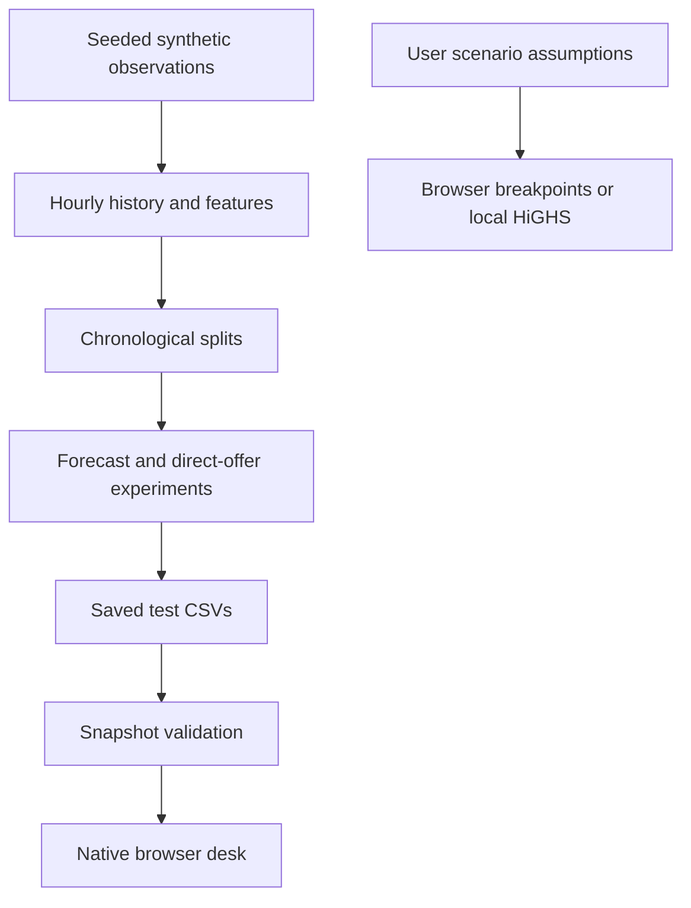

# Architecture: observations, offers and evidence

**Source snapshot:** `29abf5d8bd6f05b1f0c027d8753f4837840215dc`, reviewed 19 November 2026. ZephyrTrade is a synthetic research package with a native browser desk and an optional local numerical service. Its outputs support inspection of an implemented model; they do not establish forecast availability or live trading value. [Documentation index](../INDEX.md).

## Three different browser experiences

| Surface | Actual computation | Data and persistence | Appropriate interpretation |
| --- | --- | --- | --- |
| `ZephyrTrade-Champion.html`, or the packaged `src/zephyrtrade/web/` served by Python | Native DKK/MWh settlement, retained strategy metrics and breakpoint optimization | Bundled synthetic observations; browser-local named scenario inputs | Research desk and hypothetical offer study |
| `docs/index.html` | Separate USD/basis-point cost sensitivity proxy, selected from a shared teaching runtime | Embedded configuration, four guided modules; experiment progress is in memory | Learning companion; no native wind model, LP, retained backtest or forecast execution |
| `docs/portfolio/index.html` | Reading-path search, filtering and study-plan tools | Six selected source-backed paths and personal learning records | A guide to source material; no numerical execution |

The native lesson catalog is another reading index with historical source locators. Keep its historical provenance separate from this review's source SHA. The existing source explicitly declares the companion's surrogate status. Sources: [src/zephyrtrade/web/index.html](https://github.com/mohammadrezwankhan/zephyrtrade/blob/29abf5d8bd6f05b1f0c027d8753f4837840215dc/src/zephyrtrade/web/index.html), [src/zephyrtrade/web/engine.js](https://github.com/mohammadrezwankhan/zephyrtrade/blob/29abf5d8bd6f05b1f0c027d8753f4837840215dc/src/zephyrtrade/web/engine.js), [docs/lesson-config.json](https://github.com/mohammadrezwankhan/zephyrtrade/blob/29abf5d8bd6f05b1f0c027d8753f4837840215dc/docs/lesson-config.json), [docs/portfolio/README.md](https://github.com/mohammadrezwankhan/zephyrtrade/blob/29abf5d8bd6f05b1f0c027d8753f4837840215dc/docs/portfolio/README.md), [docs/native-lessons.json](https://github.com/mohammadrezwankhan/zephyrtrade/blob/29abf5d8bd6f05b1f0c027d8753f4837840215dc/docs/native-lessons.json).

## Research flow

`data_loader.py` generates four synthetic site proxies and synthetic market prices. It retains complete power/weather histories but filters any market interval with a negative day-ahead, up- or down-regulation price. `preprocessing.py` constructs lagged and trailing power features before the market join, then splits the surviving observations by chronological row count. A training-only scaler transforms the 15 feature columns; evaluation prices and actual power retain their original units. Sources: [src/zephyrtrade/data_loader.py:413–503](https://github.com/mohammadrezwankhan/zephyrtrade/blob/29abf5d8bd6f05b1f0c027d8753f4837840215dc/src/zephyrtrade/data_loader.py#L413-L503), [src/zephyrtrade/preprocessing.py:120–335](https://github.com/mohammadrezwankhan/zephyrtrade/blob/29abf5d8bd6f05b1f0c027d8753f4837840215dc/src/zephyrtrade/preprocessing.py#L120-L335).

Phase 2 fits six regressors plus the persistence baseline. Training folds select polynomial regularization; an inner chronological holdout selects cluster count. The separate validation split supplies empirical residual scenarios. Test offers use those residuals and realized test prices as a controlled **ex-post** input. Phase 3 learns perfect-foresight output labels, selects candidates by inner-training-holdout revenue, and refits on the entire training split. It explicitly loads the locally weighted Phase 2 offer as its comparison, rather than dynamically selecting whichever Phase 2 strategy wins a new run. Sources: [src/zephyrtrade/phase2.py:319–578](https://github.com/mohammadrezwankhan/zephyrtrade/blob/29abf5d8bd6f05b1f0c027d8753f4837840215dc/src/zephyrtrade/phase2.py#L319-L578), [src/zephyrtrade/phase3.py:163–405](https://github.com/mohammadrezwankhan/zephyrtrade/blob/29abf5d8bd6f05b1f0c027d8753f4837840215dc/src/zephyrtrade/phase3.py#L163-L405), [src/zephyrtrade/phase3.py:532–709](https://github.com/mohammadrezwankhan/zephyrtrade/blob/29abf5d8bd6f05b1f0c027d8753f4837840215dc/src/zephyrtrade/phase3.py#L532-L709).

The pinned tree contains two retained test-prediction CSV archives, farm metadata and source provenance. It does **not** contain the original full raw power/weather/price tables, processed splits or trained-estimator payloads. A research rerun generates new files and must use new output directories. The snapshot builder consumes the retained CSVs without loading joblib/pickle objects or retraining. Its source hashes identify those CSV bytes; they do not authenticate a market provider. Sources: [scripts/build_app.py:1–258](https://github.com/mohammadrezwankhan/zephyrtrade/blob/29abf5d8bd6f05b1f0c027d8753f4837840215dc/scripts/build_app.py#L1-L258), [data/raw/provenance.json](https://github.com/mohammadrezwankhan/zephyrtrade/blob/29abf5d8bd6f05b1f0c027d8753f4837840215dc/data/raw/provenance.json), [MANIFEST.in](https://github.com/mohammadrezwankhan/zephyrtrade/blob/29abf5d8bd6f05b1f0c027d8753f4837840215dc/MANIFEST.in).

## Native interaction and trust boundaries

The browser engine is pure JavaScript with no DOM or network dependency. The interface renders a bounded HTML/SVG vocabulary, holds unapplied form drafts in memory, and blocks save/export/cross-check actions when inputs are stale. Imports validate inputs and recalculate results; imported calculated fields are not authoritative. Saved names and assumptions use `zephyr-scenarios-v1`; view and theme preferences use different keys. Sources: [src/zephyrtrade/web/app.js:24–189](https://github.com/mohammadrezwankhan/zephyrtrade/blob/29abf5d8bd6f05b1f0c027d8753f4837840215dc/src/zephyrtrade/web/app.js#L24-L189), [src/zephyrtrade/web/app.js:485–621](https://github.com/mohammadrezwankhan/zephyrtrade/blob/29abf5d8bd6f05b1f0c027d8753f4837840215dc/src/zephyrtrade/web/app.js#L485-L621).

The Python `LocalServer` binds IPv4 loopback, permits eight worker slots and one solver request at a time, and serves a fixed asset allowlist plus health and optimize routes. It has no account system, broker connector, model-serving process or live-data ingestion. Host/Origin checks constrain browser use but do not authenticate a person. The browser's five-second abort does not impose a server-side HiGHS deadline. Sources: [src/zephyrtrade/app.py:24–345](https://github.com/mohammadrezwankhan/zephyrtrade/blob/29abf5d8bd6f05b1f0c027d8753f4837840215dc/src/zephyrtrade/app.py#L24-L345), [src/zephyrtrade/web/app.js:522–533](https://github.com/mohammadrezwankhan/zephyrtrade/blob/29abf5d8bd6f05b1f0c027d8753f4837840215dc/src/zephyrtrade/web/app.js#L522-L533).

Static publication builds create separate collection and dedicated-domain artifacts. GitHub Pages publishes the `docs` tree through existing workflows. No new hosting path is introduced by the reference handbook; its generated HTML is a reading view of the canonical files. See the [publication playbook](../maintainer/CI_CD_AND_RELEASE_PLAYBOOK.md).
